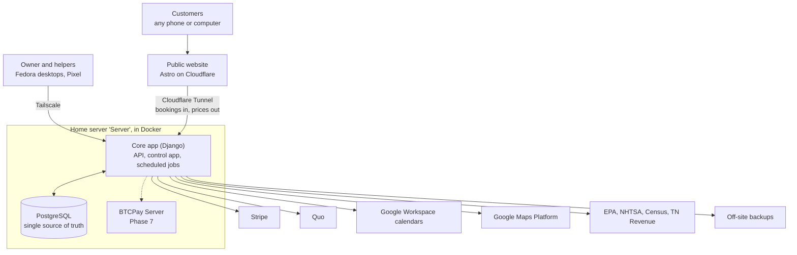

# Architecture

One database feeds the website, the control app and every outside service. Customers only ever touch the website on Cloudflare. The home server sits behind an outbound tunnel, and every outside service connects through the core app, never straight to the database.

## Components

| Component | Choice | Why |
| --- | --- | --- |
| Database | PostgreSQL | One relational store for all business data. Free, mature, simple to back up. |
| Core app | Django (Python) | Logins, permissions, migrations and an admin screen for every table come built in. |
| Control app | Web app served by Django | Runs in Firefox on Fedora and installs on the Pixel. Nothing to install per machine. |
| Public website | Astro, static | Plain HTML with almost no JavaScript: fast and strong for SEO. |
| Website hosting | Cloudflare free plan | Unlimited static requests and bandwidth. The site stays up if the server is down. |
| Site-to-server link | Cloudflare Tunnel | Outbound-only. No open ports, no static IP. |
| Reverse proxy | Caddy | Serves the whole app to the tailnet and only the health page and public API to the tunnel. |
| Private access | Tailscale | Already in use. The control app is never on the public internet. |
| Scheduling | Built into the core app | Services, durations and availability live in the same database. Replaces Setmore. |

## How data moves

- **Prices and service descriptions** are published to the website at build time. Saving a pricebook change in the control app triggers a site rebuild, live within a few minutes.
- **The booking flow** reads live prices and open slots from the core app's API through the tunnel. The final price is always calculated on the server.
- **If the server is unreachable,** the site and its prices still load, and the booking form switches to a "request a time" form that Cloudflare holds and delivers when the server returns.
- **Outside services** (Stripe, Quo, Google) report back to the core app by webhook through the tunnel.

## Hosting

The business data lives on the owner's home server. An APC battery covers the server, firewall and modem. A free outside monitor checks the booking service every few minutes. If it records more than one outage a month during booking hours, or any outage over four hours, the same Docker stack moves to a cloud server, at about $14 to $29 a month.

## Network

- The control app listens only on the server's loopback address (Caddy on `127.0.0.1:8000`) and is published to the tailnet with `tailscale serve`.
- The tunnel reaches Caddy's port 8080 over a private Docker network. That port serves only `/health` and `/api/public/`, and the app enforces the same rule. Details are in [setup/stack.md](setup/stack.md).
- The server is its own Tailscale node, in addition to the pfSense subnet route. See [setup/server.md](setup/server.md).
- The public API exposes three things only: list services and prices, show open slots, and take a booking.
- Card details never touch the server.

## Backups

- The database lives on the NVMe drive.
- Nightly dumps go to the RAID array at `/mnt/raid`, and an encrypted copy goes off-site.
- RAID 5 survives one failed disk but not deletion, corruption, fire or theft, so the off-site copy is the real backup.
- A restore is tested in Phase 0 and again before launch.
