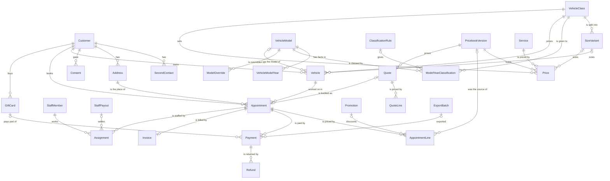

# Data model

This page describes the database as the Phase 1 code builds it. The models live in the Django apps under `app/`, one app per area, and the code is the authority: if this page and the code disagree, the code is right and this page needs fixing. The tables exist, but the screens to fill them and the import that loads them come later in Phase 1 and in later phases.

## The main records

## Customers and vehicles

The `customers` and `vehicles` apps.

- **Customer** holds a name, company, mobile number, email, where the customer came from, and notes. Some imported customers have no number; they are kept.
- **Second contact** holds another person's own name and number on a customer's record, such as a spouse. A booking under that number matches the customer. See [../reference/returning-customers.md](../reference/returning-customers.md).
- **Address** holds a service address with its coordinates, Google place ID, tax jurisdiction and whether it has been verified. An imported address keeps an import key naming the Baserow customer it came from. An address outside the service area that the owner has allowed is marked as an approved out-of-area address.
- **Consent** holds one answer to a text consent question: appointment or follow-up, yes or no, the number, where it was given (web form, phone, text reply or import) and the wording version. Answers are never edited. A STOP reply adds a "no", so the latest answer counts and the whole history stays. See [../reference/text-messages.md](../reference/text-messages.md).
- **Vehicle class** is a group of vehicles that share prices, with its settings: what its size variant measures (doors, cab style, seat rows or none), whether customers book it online or ask for a quote, and its photo card's caption. Each class also records its price basis: the fixed price list, the only one built, which leaves room for another way of pricing, such as per foot of length (decision 0060). There are seven at launch, Motorcycles among them (decision 0072), listed in [data/vehicle-classes.yaml](../../data/vehicle-classes.yaml).
- **Size variant** is one size within a vehicle class, such as "two doors" or "three rows", with the number used in the price matrix's size column. A class with no size variants, such as motorcycles, has a single price per service.
- **Vehicle model** is a make and model a customer picks, such as Toyota RAV4, over a range of model years, with its vehicle type (car, truck or van, or motorcycle), a flag set when the booking form asks the size for any of its model years, and where it came from (EPA, NHTSA or the owner). The vehicle data import fills these and never changes one whose source is the owner ([../reference/vehicle-catalog.md](../reference/vehicle-catalog.md), decision 0071).
- **Model-year facts** are one source's facts about one model year of a vehicle model: the EPA size classes, drives, body styles, cab styles, seat rows and the source's vehicle types as lists, and passenger and luggage volume, GVWR, curb weight, length, width, height and wheelbase as a lowest and highest value across the source's rows, with the source's own ids, how the source's rows spread across each fact (for the majority rule, decision 0074), and when the record was first and last seen. Each source (EPA, vPIC, the Canadian specifications, the third-row list or the owner) has its own record, so no source overwrites another, and no import touches the owner's.
- **Vehicle data import run** records one run of the vehicle data import for one source: start, end, whether it was a dry run, its counts and its result.
- **Classification rule** is one rule of the ordered list that classifies model years: a position, a name, its conditions on stored facts, the vehicle class it gives, whether it is active, and, for a launch rule, the entry in data/vehicle-classes.yaml it was made from, so an unedited one follows the file (decisions 0060 and 0074, [../reference/vehicle-classification.md](../reference/vehicle-classification.md)).
- **Model override** is the owner's vehicle class for a vehicle model, for all its years or a range of them, which beats every rule. It fixes the size variant, always asks it, or leaves it to the facts, and records who set it, when, and a note.
- **Model-year classification** is a model year's vehicle class and size variant, or that the size is asked, as `classify_vehicles` last applied the rules and overrides, with the rule or override behind it. One waiting in the review queue has the reasons, and keeps an earlier class while it waits (decision 0073).
- **Vehicle** belongs to a customer, with year, make, model, color, vehicle class and size variant. A per-vehicle override, such as for a lifted vehicle, marks the class and size variant as set by hand, with who set them, when and a note; it beats the model override and the rules. It is named with its color wherever it is listed or picked, as in "2019 Honda Accord, silver" (decision 0067). Any of those may be missing on older records. The vehicle is kept and its missing details are listed to fill in. A size variant counts as missing only when the class has size variants.

**Vehicle classes and size variants are records, not choices in code.** Adding, renaming or retiring one is done in the database and needs no code change or migration. A new class gets its prices in the next pricebook version. Nothing is deleted: a retired class or size variant is kept for history, cannot be priced again, and every past job keeps the name and size it was booked under.

## Pricebook and promotions

The `pricebook` and `promotions` apps. Prices are loaded from [data/price-matrix.csv](../../data/price-matrix.csv) by the `load_pricebook` command and never written in code. The pricing engine in `pricebook/pricing.py` is the only code that works out a price (decision 0059).

- **Pricebook version** is a numbered state of the pricebook: a draft while the owner edits it, then published with an effective date. A published version, and everything in it, can never be changed or deleted; a change is a new draft that becomes the next version (decision 0033).
- **Service** holds a service's name, kind (main service, add-on, maintenance plan or custom line), description, whether the condition adjustment applies, whether customers can book it online, whether it is on the price list, and its default crew size. Past services such as PPF Removal are kept off the price list.
- **Price** is one cell of the price matrix in one version: a service's price and one-person service hours (setup and breakdown not included, decision 0058) for a vehicle class and, where it matters, a size variant of that class. A class with no size variants, or a service that ignores size, has one price per class.
- **Derived price rule** prices a service as a percentage of another for the same vehicle class and size variant, with its hours. Quarterly Maintenance is 80% and Monthly Maintenance 50% of Full Detail, stored as rules rather than prices, so a Full Detail price change moves both. See [../reference/pricing.md](../reference/pricing.md).
- **Condition level** holds each of the three condition levels with the percentage it adds, in each version. The same percentage adds to the main service's price and to its service time (decision 0065).
- **Pricing rules** holds a version's two-person time factor, service-time rounding and full-day threshold, which counts one-person time on site.
- **Quote** is a priced job issued by the server before booking, the price of record (decision 0059): the service, vehicle class, size variant, condition level, add-ons, promotions and crew size asked for; the pricebook version; the total before tax, tax rate, sales tax and total; the one-person service hours; and the setup, service, breakdown and time-on-site minutes, with the full-day flag. A **quote line** holds each priced line. A quote never changes once issued, and its lines become an appointment's lines exactly when it is booked. Sales tax is zero until Phase 3.
- **Promotion** is a named offer, such as Friends & Family, Multi-Vehicle or a seasonal offer. It is a percentage off, a dollar amount off, a fixed price, or a free voucher. A **voucher** must have a code; its dollar value comes off the job as a promotion line, never more than the job's price (decision 0054). It can have dates, a promo code, a website banner, and the services it applies to (none listed means every service).

## Appointments

The `appointments` app.

- **Appointment** is one job: a customer, a vehicle, a service address and a start (arrival) time, with its status (requested, booked, completed or canceled), where it came from (website, owner or import), crew size, its setup, service and breakdown minutes as booked (decision 0056), the quote it was booked from, preferred payment method and the Jobs calendar event it is mirrored to. Its total before tax is the sum of its lines, and its time on site the sum of its three times. Imported jobs may have no times.
- **Appointment line** is the line snapshot (decision 0033). Each priced item on a job is copied onto the appointment when it is booked, from its quote: the description, amount, one-person service hours, the vehicle class name and size variant (number and label) as booked, the condition level, and the pricebook version it came from. A later pricebook change, or renaming or retiring a vehicle class or size variant, cannot alter it. One appointment has several lines: a main service, its add-ons, the condition adjustment, any promotion, and any of these:
  - an **on-site adjustment**, when the final price differs from the list price, always with a reason;
  - a **no charge** line, when a job is given as a gift, with a reason, bringing the total to zero;
  - a **custom line**, such as Misc Services, at a price the owner sets.
- **Recurring series** ties repeating Monthly or Quarterly Maintenance visits for one vehicle together.
- **Match flag** records a difference in name, address or vehicle between a booking and the customer it was quietly matched to, and which of the four actions the owner chose (decision 0034).
- **Repricing decision** logs the owner's choice for a booked job when a pricebook version is published: keep the booked price, use the new price, or a custom amount, with both amounts.
- **Day closure** is a day closed for booking, set in the control app or read from the Time Off calendar.

## Billing and sales tax

The `billing` app. Every amount of money is an exact decimal (decision 0047).

- **Payment** is money, or goods in a trade, received for an appointment: the method, the amount toward the job, the tip, when it was paid, a reference such as a check number, and the processor fee. A job paid two ways has two payments, except an imported payment split between two methods whose amounts were never recorded: it is one payment with a split method (decision 0066). An imported payment keeps an import key naming its Bookkeeping row. A gift card or other prepayment is a payment recorded before the job. A tip can be negative: a customer who paid less than the total is recorded with a negative tip. A trade must say what goods were received, and its amount is their value. See [../reference/payments.md](../reference/payments.md).
- **Gift card** is a dollar balance sold in advance, sales tax included, with a code, the buyer, an optional recipient and how the buyer paid. Its balance is the amount sold less the gift-card payments made from it. Paying with a card uses as much of the balance as the bill needs and never takes it below zero, so the rest of the bill becomes a second payment by another method. The one imported gift-card job has a gift-card payment with no card (decision 0054).
- **Payment methods** are card, Cash App Pay, Cash App to the owner's $cashtag, Venmo, PayPal, cash, bitcoin, check, trade and gift card. Check and trade are owner-only and never offered on the website (decision 0053).
- **Invoice** holds a completed job's bill: the number, the tax jurisdiction, the state and local rates as charged, the taxable amount, each tax and the total. The rates are copied, so a later rate change cannot alter it.
- **Refund** holds an amount returned on a payment, the tax refunded and the reason.
- **Tax jurisdiction** is a state, county or city, and **tax rate** is its state and local rates from a start date. A job is taxed at the rate in effect on the day of service. See [../reference/sales-tax.md](../reference/sales-tax.md).

## Staff

The `staff` app.

- **Staff member** is the owner or a helper, with a phone number, a login if they have one, a flat pay per job, and where their drive times start. Every helper has a pay type: family helper, the only one in use, or employee, which is planned. The owner has none.
- **Assignment** puts a staff member on a job. Their per-job pay is copied when they are assigned, so a later change to it does not alter past jobs. The owner can override the pay for one job. An assignment of someone not yet authorized for the job's services, for training, records the reason (decision 0061).
- **Staff payout** is money paid to a helper, settling one or more assignments. An imported payout keeps an import key. It keeps the helper's pay type from when it was made, and the pay type sets its GnuCash account: Professional Services for a family helper. An employee's wages account and payroll are a later decision (decision 0053).

## Bookkeeping, messages and marketing

The `bookkeeping`, `messaging` and `marketing` apps.

- **Export batch** is one GnuCash export. Payments, refunds and staff payouts point to the batch that exported them, so nothing is exported twice. Bitcoin, trades and the imported gift-card prepayment are listed for manual entry instead. Gift card sales point to their batch too. See [../reference/bookkeeping-gnucash.md](../reference/bookkeeping-gnucash.md).
- **Message template** holds the editable wording of one automated text and the consent it needs.
- **Message** logs every text sent or received, with its number, wording, delivery status and the customer and appointment it belongs to.
- **Review request** records the request sent after a paid job and whether a review followed.
- **Campaign** is a set of follow-up texts sent to chosen customers with follow-up consent, with one **campaign recipient** per customer.

## Rules that apply to every record

- **Phone numbers** are stored as 10 digits, with no formatting or country code. A number typed in any common format is reduced to its digits when it is saved or searched for, and the database refuses anything else (decision 0049).
- **Times** are stored in UTC and shown in Eastern time (decision 0048).
- **Money** is stored as exact decimals, never floating point (decision 0047).
- **Change history.** Every change to the pricebook, promotions, customers, their second contacts and addresses, vehicles, and appointments and their lines keeps the earlier version: who changed it, when, and the old values. This is done with django-simple-history (decision 0050).
- **Imported records** keep the id of the Baserow row they came from, on customers, vehicles and appointments, and an import key on addresses, payments and helper payouts, so the import can be re-run before launch (decision 0051). Imported payments and payouts belong to the export batch "Already in GnuCash: Baserow import" (decision 0066).
- **Nothing is deleted from under a job.** A customer, vehicle, address, service, promotion or pricebook version that a job refers to cannot be deleted.

## Planned: records decided but not built yet

Everything above describes the code as it is. This section is the exception: it describes records the owner decided on 2026-10-17 that the code does not have yet. Each will move into the sections above, in the present tense, when it is built.

- **Staff authorization** links one staff member to one service they may perform: every active service, add-ons included, but not history-only services or custom lines. The staff page and the service page both edit these records, with their change history. Managers (staff with the owner role, so only the owner today) are authorized for every service without a record, so a new service starts with only managers authorized (decisions 0061 and 0069).
- **Scheduling settings** will hold the live values of the rules in [data/booking-rules.yaml](../../data/booking-rules.yaml), with change history. Built in Phase 3 (decision 0056).
- **Arrival and departure** will be stored on each appointment, each with how it was recorded (tap, automatic or edited), and corrections logged. Built in Phase 4 (decision 0062).

## What is not built yet

- Settings such as working hours, start times, setup and breakdown, the home base and buffers. Their launch values are in `data/` until the scheduling work in Phase 3.
- Every screen of the control app, the Django admin and sign-in.
