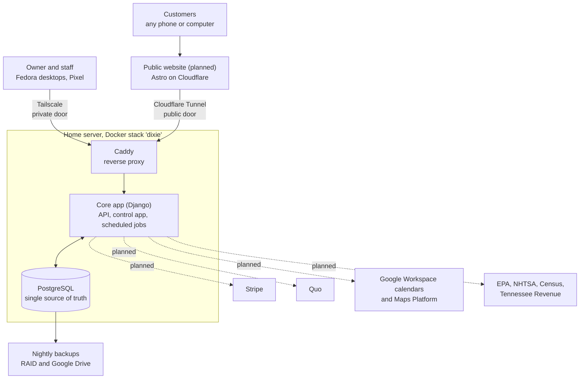

# System overview

One database feeds the website, the control app and every outside service. Customers only ever touch the website on Cloudflare. The home server sits behind an outbound tunnel, and every outside service connects through the core app, never straight to the database.

Phase 0 built the foundation: the server stack, private and public access, backups and monitoring. The website, the business screens and the outside services arrive in later phases; parts not built yet are marked "planned" below.

## Components

| Component | Choice | Why | Status |
| --- | --- | --- | --- |
| Database | PostgreSQL | One relational store for all business data. Free, mature, simple to back up | Running, empty |
| Core app | Django (Python) | Logins, permissions, migrations and an admin screen for every table come built in | Running, health page only |
| Control app | Web app served by the core app | Runs in Firefox on Fedora and installs to the Pixel's home screen; nothing to install per machine | Planned (Phase 1) |
| Reverse proxy | Caddy | Gives the app two separate doors, one private and one public | Running |
| Private access | Tailscale, with `tailscale serve` | Already in use by the owner; the control app is never on the public internet | Running |
| Public access | Cloudflare Tunnel | Outbound-only connection: no open ports, no static IP | Running |
| Public website | Astro static site on Cloudflare's free plan | Plain HTML is fast and strong for search; the site stays up when the server is down | Planned (Phase 3) |
| Scheduling | Built into the core app | Services, durations and availability live in the same database; replaces Setmore | Planned (Phase 3) |
| Secrets | Bitwarden Secrets Manager | The owner's standard; nothing secret stored in plaintext | Running |
| Backups | pg_dump to the RAID, restic to Google Drive | The database is the business | Running |
| Monitoring | Healthchecks.io | Emails the owner when backups stop or the public path breaks | Running |

## How data moves (once built)

- **Prices and service descriptions** are published into the website when it is built. Publishing a pricebook change in the control app triggers a site rebuild, live within a few minutes.
- **The booking flow** reads live prices and open slots from the public API through the tunnel. The final price is always calculated on the server; the website only displays it.
- **If the server is unreachable,** the website and its prices still load, and the booking form switches to a "request a time" form that Cloudflare holds and delivers when the server returns.
- **Outside services** report back by webhook through the tunnel: Stripe for payments, Quo for replies.
- **Calendars** receive one event per appointment from the core app; the Time Off calendar is read back to close days.
- **GnuCash** receives a CSV export that the owner imports. Nothing writes to GnuCash directly.

## Principles every part follows

1. **PostgreSQL is the single source of truth.** The website, calendars and outside services are mirrors or consumers, never sources.
2. **Prices come only from the pricebook.** No price is ever hard-coded.
3. **The control app is private.** The public API does three things only: list services and prices, show open slots, take a booking.
4. **Secrets live only in Bitwarden.** See [secrets.md](secrets.md).
5. **Card details never touch the server.** Stripe handles them.
6. **Texts go only to customers with the right recorded consent.** See [../reference/text-messages.md](../reference/text-messages.md).
7. **Linux-first.** Anything the owner runs locally works on Fedora.
